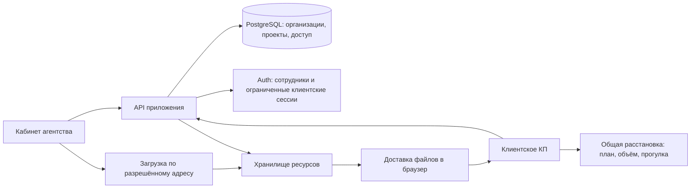

# Техническое направление и стартовая инфраструктура

Дата: 5 ноября 2026 года. Статус: архитектурная гипотеза для пилота. Сервисы не заказаны, мощности не проверены нагрузочным испытанием.

Уточнение после обсуждения: целевой рынок — Россия. Первоначальная связка облачных Vercel/Supabase не выбрана для production. Ниже сохранены исходные технические соображения и справочные тарифы; они не заменяют [исследование российского контура данных](../research/RUSSIAN_DATA_CONTOUR.md). Конструктор помещений и общий каталог пока являются гипотезами; [способы получения геометрии](../research/VENUE_SUPPLY_OPTIONS.md) обсуждаются отдельно.

## Начальная структура

Рассматривается модульное приложение на TypeScript: кабинет и просмотр КП, серверный API, общий доменный модуль расстановки. Кандидаты прикладного слоя: Next.js, Three.js, PostgreSQL. Российские провайдеры, авторизация и хранилище сравниваются отдельно. Облачные Supabase/Vercel могут рассматриваться для опытов на синтетических данных; самостоятельное размещение Supabase в РФ требует отдельной оценки эксплуатации. Конкретные версии и вспомогательные библиотеки выбираются перед реализацией по актуальной документации.

Начать с одного приложения и одной производственной БД с разделением организаций. Отдельные базы на каждое агентство, микросервисы, Kubernetes и серверный рендеринг каждого 3D-кадра пока не обоснованы. Тяжёлая обработка ресурсов может быть отдельным заданием; это не требует разделять весь продукт на сервисы.

Большие модели загружаются напрямую в хранилище по выданному разрешению; API проверяет права, размер, комплектность и завершение загрузки. Модели не передаются через API на каждый просмотр. Производственные данные не используются в preview-развёртываниях. Регион API и БД выбирается согласованно после определения рынка и проверки задержек.

## Документ и пространство независимы

КП состоит из содержимого и необязательных пространственных разделов; оно может иметь ноль, одну или несколько локаций. Создание черновика и публикация содержательного предложения не требуют обязательного `room_id`, сцены или точной даты. Локация в программе может пока иметь только описание; её нельзя отождествлять с готовой геометрической моделью.

Тип события — настройка начального состава блоков и подсказок, а не жёсткая схема из обязательных полей банкета. Расчёт, программа и команда работают без пространственного модуля. Каждый подключённый пространственный вариант ссылается на свою геометрию и расстановку; ограничения конкретной сцены не должны мешать составлению КП других типов событий. Поведение редактора обсуждается в [сквозном сценарии](../research/PROPOSAL_FLOW.md).

## Общая модель сцены

Каноническая расстановка содержит версию помещения, список экземпляров мебели, версии элементов каталога, координаты, повороты и параметры разрешённых зон. Координатная система, начало отсчёта, метры и оси фиксируются в контракте импорта.

План, объём и прогулка — три представления одного состояния. Переключение камеры не копирует сцену в отдельный формат с независимыми координатами.

Каталожная мебель имеет неизменяемые реальные размеры; замена размера означает другой каталожный вариант. Сцена, танцпол и зона подачи имеют разрешённые минимум/максимум/шаг и отдельные правила формы. Их параметризация не равна свободному масштабированию любой модели.

У объекта отдельно определяются визуальная модель, физический габарит, контур размещения и зона обслуживания/прохода. Стол со встроенным набором стульев не должен ещё раз добавлять места за эти стулья. Вместимость комнаты и число мест в расстановке отображаются отдельно; приложение не выводит безопасность мероприятия только из числа стульев.

Редактор проверяет размещение до подтверждения действия. Сервер повторяет бизнес-проверки перед сохранением/публикацией; нельзя обойти их отправкой собственного JSON. Пороговые значения проходов и ограничения задаются для помещения и сценария после согласования с площадкой; это не универсальная сертификация эвакуации.

## Комплект помещения

- Оптимизированная визуальная модель, кандидат на формат — GLB/glTF; сжатие и декодеры проверяются на целевых устройствах.
- План в масштабе и проверенные контрольные размеры.
- Пол, стены, колонны, неподвижные объекты и входы в общей системе координат.
- Запретные зоны, обязательные проходы, допустимые области размещения и ограничения высоты.
- Навигационная поверхность или эквивалентные данные для прогулки.
- Точки старта камеры, превью и описание качества/точности комплекта.
- Манифест с версией формата, хешами файлов, размерами и зависимостями.

Фотограмметрия, панорамы и иные результаты съёмки оцениваются по пригодности, а не только по фотореализму. Визуальная модель должна показывать пространство без уже установленной подвижной мебели, которую пользователь может расставлять заново. Иначе получаются дубли и ложная свободная площадь.

Навигация по статичному помещению дополняется динамическими препятствиями расстановки. Готовая navmesh пустого зала сама по себе не запрещает пройти через добавленный диван. Для пилота достаточно одноуровневого помещения; лестницы, балконы и сложные перепады — отдельная проверка.

## Доступ и библиотеки

Все сущности агентства имеют `organization_id`. Членство и роль проверяются на сервере и политиками RLS для доступных через Supabase API таблиц. Уникальность и внешние связи должны препятствовать связыванию объектов разных организаций. При изменении роли нельзя рассчитывать только на давно выданный JWT.

Публичные данные выпуска КП отделяются от внутренних заметок, закупочных цен, контактов подрядчиков и маржи. Не передаём внутреннюю запись целиком с последующим скрытием полей в браузере.

Площадка и мебель имеют владельца и отдельные разрешения использования выбранными агентствами. Пользователь не получает общую видимость чужих проектов. Доступ выдаётся к конкретным версиям ресурсов. Нужно заранее определить поведение при отзыве разрешения: рабочая рекомендация — запрет новых использований с сохранением законно выпущенных КП до согласованного срока, кроме специальных случаев немедленного отзыва.

Чувствительные файлы — в приватном хранилище. Для чтения приватных объектов Supabase поддерживает авторизованную загрузку и ограниченные по времени подписанные ссылки; публичный bucket делает файлы доступными по URL независимо от приватности строк БД. Источник: [модель доступа Storage](https://supabase.com/docs/guides/storage/buckets/fundamentals).

Ссылка на КП использует непредсказуемый секрет с ограничениями и возможностью отзыва; короткий адрес или поддомен не являются авторизацией. Секрет не попадает в аналитику, логи и referer. Храним хеш токена; после проверки можно выдавать ограниченную клиентскую сессию. Права просмотра и создания вариантов разделяются. Анонимному клиенту не требуется платный аккаунт агентства.

Ссылка, которой может поделиться получатель, не доказывает личность человека. Для атрибутированного согласования рассматривается простое подтверждение email; юридически значимая подпись не входит в MVP. У каждого клиентского варианта фиксируются исходный выпуск, отдельный владелец/участник и полномочия на изменение.

Владелец SaaS управляет платформой отдельными полномочиями. Служебный просмотр клиентских материалов не выдаётся всем администраторам автоматически; административные действия журналируются. Секретные серверные ключи не передаются в браузер.

## Автосохранение и версии

Во время редактирования команды меняют локальное состояние и поддерживают undo/redo. Сохранение отправляет изменения после завершения жеста и короткой задержки, а не при каждом кадре перемещения.

Черновик имеет номер редакции; сервер принимает запись только при совпадении ожидаемой редакции. При конфликте нельзя молча перезаписывать состояние. Публичный выпуск, именованный вариант и рабочий черновик — разные сущности.

Автосохранение обновляет черновик, не создавая запись в видимом списке вариантов на каждый сдвиг. Для восстановления допустим ограниченный набор технических контрольных точек с отдельным сроком хранения. Именованные варианты и публикации создаются явными действиями. Миниатюра привязана к конкретной редакции, а не случайному более позднему состоянию.

## Домены и биллинг

Предлагаемый начальный адрес: `<agency>.<platform-domain>/p/<proposal>`. Все адреса обслуживает одно приложение; создание предложения не вызывает сборку и деплой. Требуются wildcard DNS/TLS и проверенный реестр поддоменов, а не доверие к произвольному заголовку Host.

Позднее собственный поддомен агентства подключается после проверки владения и выпуска сертификата. Сессии кабинета не распространяются на все клиентские домены; пользовательский контент не получает доступ к административным cookies.

Права по подписке отделены от платёжного провайдера. При интеграции нужны проверка подлинности webhook, идемпотентность событий, корректная обработка повторов/порядка, сверка с провайдером и журнал изменений прав. До выбора географии провайдер не закрепляется в архитектуре.

## Справочные цены первоначальной зарубежной гипотезы

Раздел отражает предыдущее исследование. Эти сервисы не утверждены для российского production; приведённые суммы не являются его текущим бюджетом.

Официальные страницы проверены 5 ноября 2026 года. Цены в USD; налоги, курс, доступность оплаты в выбранной юрисдикции и перерасход учитываются отдельно.

| Статья | Подтверждённая исходная величина |
| --- | --- |
| Vercel Pro | От $20/месяц; места разработчиков и расход ресурсов влияют на итог. [Тарифы](https://vercel.com/pricing) |
| Vercel Hobby | Ограничен личным некоммерческим использованием. [Условия плана](https://vercel.com/docs/plans/hobby) |
| Supabase Pro | От $25/месяц; $10 compute-кредита покрывают один Micro. [Тарифы](https://supabase.com/pricing) |
| Micro | 1 GB RAM, shared compute, 60 прямых подключений / 200 pooler-подключений. Это лимиты соединений, не число поддерживаемых посетителей. [Тарифы](https://supabase.com/pricing) |
| Включённые ресурсы Pro | 8 GB диска БД на проект; 100 GB файлов; 250 GB uncached и отдельно 250 GB cached egress. [Тарифы](https://supabase.com/pricing) |
| Дополнительный проект Supabase | Compute начинается от $10/месяц после использования кредита первым проектом. [Тарифы](https://supabase.com/pricing) |

Расчётный нижний уровень для одного разработчика, одного production Micro и отдельного staging Micro: около **$55/месяц** до дополнительных расходов, при текущей модели тарифов и включённых квотах. Это не полная стоимость эксплуатации.

Для планирования малонагруженного пилота разумно резервировать **$75–150/месяц** на инфраструктуру: базовые сервисы плюс домен, отправка служебных писем, отдельные резервные копии и наблюдаемость. Это собственная оценка бюджета, не тарифный пакет поставщиков и не гарантированный потолок. Работа, съёмка, моделирование, поддержка клиентов и комиссионные платежей сюда не входят.

Грубая модель трафика: `просмотры × средний объём фактической загрузки`. При 50 MB новых ресурсов на просмотр 1 000 просмотров дают около 50 GB, 10 000 — 500 GB, 100 000 — 5 TB. Это десятичные единицы, без накладных расходов, повторов, загрузок и служебного трафика. Доля CDN/browser cache меняет счёт, но не отменяет стоимость cached egress. Поведение подписанных ссылок и кеша необходимо измерить на пилоте.

Начальное ограничение — размер и скорость загрузки ресурсов на клиентском устройстве, а не только CPU базы. Исходные съёмки не выдаются посетителям КП. Оптимизированные модели версионируются и доставляются из хранилища/CDN; локальные копии и резервные копии тоже входят в расчёт хранения.

## Производительность и рост

Предварительный профиль испытания: 3 агентства, 1–3 помещения, 10 менеджеров, 20 одновременных читателей и 5 активных редакторов. Нагрузочное испытание должно отделять скачивание файлов, запросы API и сохранение сцен. Это стартовая проверка, не заявленная ёмкость продукта.

Предварительные цели для одной пилотной сцены:

- 3D не блокирует открытие текстового КП; при недоступном WebGL остаются текст, расчёт и статичный план.
- Полный набор оптимизированных ресурсов ориентировочно 30–60 MB; начальная загрузка заметно меньше. Уточнить после реального импорта.
- На согласованном устройстве при канале 20 Mbit/s интерактивная сцена появляется не позднее 10 секунд после запуска 3D в холодном кеше.
- Цель — не менее 30 FPS на согласованном устройстве со сценой до 200 размещаемых экземпляров; отдельно измерить загрузку и рабочую память.
- p95 обычных API-запросов менее 500 ms на согласованном профиле, без времени скачивания моделей.
- Сохранение завершённого действия подтверждается сервером; сетевые ошибки и неподтверждённые изменения видны пользователю.

До приёмки фиксируются точные устройства, браузеры, разрешение экрана, версия модели и метод измерения. Показатели нельзя объявлять достигнутыми без испытаний. Мобильный просмотр и прогулка проверяются отдельно; полноценное редактирование на телефоне — отдельное обязательство, если войдёт в согласованный MVP.

Сначала измеряем медленные запросы, CPU/RAM, использование соединений, объём scene JSON и байты на просмотр. При устойчивом приближении к лимитам или нарушении p95 оптимизируем запросы и пул, затем увеличиваем compute. При росте библиотеки/трафика сравниваем хранилища по реальным счетам и модели доступа. Тяжёлую обработку выносим в повторяемые задания, если она появляется в продукте. Отдельные базы крупных клиентов и распределение по регионам рассматриваются при подтверждённых требованиях.

## Эксплуатация и критерии выпуска

Обязательны раздельные среды, воспроизводимые миграции, проверки доступа между организациями, наблюдаемость ошибок, учёт расхода, ограничение злоупотреблений публичными ссылками, проверка зависимостей и сценарий отката приложения с совместимой схемой БД.

Supabase Pro предоставляет ежедневные резервные копии БД с историей 7 дней, но они **не содержат файлы Storage**. Нужны независимая копия файлов, реестр версий и пробное совместное восстановление. Источник: [резервное копирование Supabase](https://supabase.com/docs/guides/platform/backups).

Для пилота предлагаем согласовать RPO до 24 часов и RTO до 8 часов, после чего подтвердить их учебным восстановлением. Это цели процесса, не обещанный SLA. Более строгая допустимая потеря изменений требует более частых копий/PITR и отдельного бюджета. Новые ресурсы копируются до признания комплекта восстановимым; опубликованный выпуск не должен ссылаться на потерянный файл.

Перед реализацией фиксируем точную версию CLI. На 5 ноября актуальный changelog сообщает о Supabase CLI v3 и изменениях выбора локального/удалённого проекта; команды и CI нужно сверять с выбранной версией. Источник: [изменения CLI v3](https://supabase.com/changelog/supabase-cli-v3).

Решения, требующие уточнения: правовой режим фактических потоков данных для российского запуска; провайдер, бюджет и требования восстановления; способ, точность и стоимость подготовки помещения; права использования файлов; политика библиотечных разрешений и архива; устройства клиентов; допустимые лимиты тарифов; фактическая нагрузка пилотов. До этих ответов стек является кандидатом, а не окончательным обязательством.
