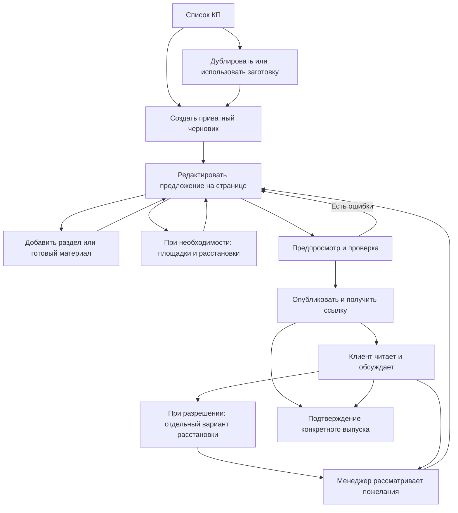

# Сквозной сценарий создания и согласования КП

Дата: 5 ноября 2026 года. Статус: предложение по поведению продукта для обсуждения и проверки. Это не утверждённая спецификация и не реализованный интерфейс.

## Что требуется от продукта

Обычный менеджер должен быстро получить осмысленный визуальный черновик, менять предложение прямо в его будущем клиентском представлении и отправить ссылку без участия разработчика. Длинная анкета перед редактором не должна быть основным сценарием.

Продукт позволяет готовить КП разных мероприятий, отдельной программы или услуги. Выбранная площадка, геометрия помещения, банкетная посадка и 3D не являются обязательными условиями создания или публикации любого КП. Пространственные инструменты сохраняют самостоятельную ценность и развиваются глубоко для поддерживаемых типов пространства.

Участники: владелец агентства, менеджер/редактор, сотрудник с правом просмотра, клиент агентства и при необходимости приглашённый представитель площадки. Их полномочия и сценарии различаются; клиентом платформы в этом документе считается агентство, получателем КП — заказчик мероприятия.

## Основная рекомендация

«Создать КП» сразу открывает приватный визуальный черновик в оформлении агентства. Если бренд ещё не настроен, используется нейтральная композиция. У черновика может быть рабочее имя «Новое предложение»; регистрация клиента в CRM, дата, город, число гостей и бюджет не запрашиваются как обязательные предварительные шаги.

Внутри редактора менеджер может выбрать стартовую структуру мероприятия, заменить композицию и редактировать обложку. Выбор формата — помощь для подбора разделов; его можно пропустить. Известные сведения заполняются в контексте. Система запрашивает неизвестные параметры только для действий, которые действительно от них зависят.

Первый полезный результат — читаемый черновик с настоящим содержимым агентства, а не просто заполненный профиль или завершённая анкета. Время до этого результата измеряется на пилотах; обещание «готовое КП за N минут» пока не подтверждено.

## Карта пути

Путь не предписывает заполнять контент строго сверху вниз. Менеджер может начать с программы, расчёта или пространства и вернуться к обложке позднее.

## Первый вход и повторная работа

| Ситуация | Предлагаемое поведение |
| --- | --- |
| Новый владелец | Подтверждает вход и создаёт рабочее пространство с минимумом сведений; настройку бренда можно продолжить из редактора |
| Сотрудник по приглашению | Попадает в существующее агентство с его оформлением и правами, без повторного создания организации и выбора подписки |
| Новый черновик | Сразу открывается визуальный документ в последней выбранной или установленной агентством композиции |
| Повторное предложение | Доступно дублирование существующего КП; новая копия приватная, без старых ссылок и согласований |
| Часто повторяемый формат | Можно применить сохранённую структуру агентства или вставить готовые программу, описание услуги, команду |
| Возврат к работе | Открывается сохранённый черновик, сохраняется позиция и виден статус изменений относительно отправленного выпуска |

Демонстрационное предложение существует отдельно от рабочего. Примеры и редакторские подсказки визуально отличаются от реальных условий и не публикуются как фактические данные.

## Рабочий экран

В центре — адаптивная страница КП с реальным текстом, изображениями и расчётом. Слева — краткое оглавление, которое одновременно служит переходом между разделами. Сверху — рабочее имя, состояние сохранения, отмена, предпросмотр и публикация.

Панель параметров появляется при выборе соответствующего объекта, а не занимает экран постоянно. Между разделами доступно «Добавить раздел». У существующего раздела есть краткое меню: переместить, изменить композицию, дублировать, скрыть/удалить. Названия действий должны совпадать во всех блоках.

Не делать отдельный экран редактирования для каждого текстового поля и не предлагать произвольные координаты, z-index или сетку технических настроек обычному менеджеру. Основная рабочая поверхность предполагается для компьютера; полный мобильный клиентский просмотр обязателен. Объём мобильного авторского редактирования выбирается отдельно.

## Как меняется содержимое

| Действие менеджера | Поведение |
| --- | --- |
| Нажал заголовок или абзац | Пишет прямо в документе, видит короткую панель форматирования |
| Нажал фотографию | Заменяет изображение и меняет фокус кадрирования |
| Выбрал карточку активности | Меняет описание/изображение на месте; может выбрать материал агентства |
| Переставляет раздел | Использует перетаскивание за ручку или команды «Выше»/«Ниже» |
| Меняет расположение элементов | Выбирает композицию и допустимые колонки/пропорции; система сохраняет мобильные правила |
| Редактирует программу | Меняет строки времени и содержимое непосредственно в разделе; сложные дни/потоки раскрываются в рабочем режиме программы |
| Редактирует расчёт | Меняет структурированные строки, количества, единицы и цены; итог рассчитывается из данных |
| Меняет расстановку | Открывает полноразмерный рабочий режим и возвращается понятным действием «Вернуться в КП» |

Текстовая каретка и перетаскивание раздела не должны конкурировать за один жест. Управление не зависит только от наведения мыши; основные действия доступны с клавиатуры и через одиночные нажатия без drag. Цель отмены названа явно. Для прототипа предлагается единая история личных содержательных операций текущего рабочего варианта, включая его сцены; активная правка текста имеет локальную отмену. Переход между КП/самостоятельными альтернативами не переносит историю, навигация камеры в неё не входит. Граница текстовой серии требует технической проверки. Переключение режима не сбрасывает несохранённую работу.

## Свобода композиции

Предлагается направляемый визуальный редактор: свободный порядок смысловых разделов, собственный контент, смена предусмотренных композиций, настройка бренда, кадрирование и варианты группировки.

Полностью свободный пиксельный холст — отдельная продуктовая гипотеза. Он требует ручного решения переносов, перекрытий и мобильной вёрстки. Его нельзя обещать как автоматически простой интерфейс для менеджера. Больше свободы можно добавить в ограниченные области, например обложку, после проверки базовых сценариев.

Последствия смены композиции, скрытия/удаления и отмены уточнены в [правилах редактора](EDITOR_INTERACTION_CONTRACT.md). Сохранить поле в данных, но незаметно убрать его из отображения — недостаточно для обещания «содержимое сохраняется».

Композиция оформления, формат мероприятия и содержимое — разные настройки. Смена оформления не должна удалять программу или менять цены. Смена стартового формата после заполнения предлагает недостающие разделы и не перезаписывает сделанное.

## Где вводить базовые сведения

| Сведения | Где и когда нужны |
| --- | --- |
| Название предложения | На обложке; внутреннее рабочее имя можно менять отдельно |
| Заказчик | На обложке/в данных предложения; запись контакта не обязательна для первого редактирования |
| Тип события | Необязательный выбор структуры и подсказок, доступен внутри редактора |
| Город | При подборе места, обсуждении логистики или указании географии события |
| Дата | В обложке и программе; допустимы период, месяц или состояние «Уточняется» |
| Число гостей | При описании масштаба, расчёте услуг на человека и проверке посадки; может быть диапазоном |
| Бюджет | Как ограничение при подборе либо в расчёте; неизвестный бюджет не равен нулю |
| Площадка | Только при добавлении соответствующего раздела; может отсутствовать или быть одной из альтернатив |
| Бренд | Значения агентства применяются автоматически; разрешённые настройки доступны в оформлении |

Общие сведения хранятся один раз и используются связанными элементами документа. Например, встроенная подпись даты берёт значение из даты мероприятия. Произвольно написанный вручную текст не должен считаться автоматически проверенным или исправленным во всём документе.

При изменении числа гостей система показывает затронутые расчёты и расстановки. Вместимость по расстановке и плановое число гостей остаются разными показателями. Нельзя автоматически увеличивать число гостей после добавления столов или незаметно менять цену из клиентского варианта.

## Состав разделов и мероприятия

Общий набор: обложка, задача и идея, состав предложения, программа, активности, место, пространство/расстановка, команда, обеспечение, расчёт, условия и следующие шаги. Нужные разделы выбираются и комбинируются. Скрытый или отсутствующий кейтеринг не является ошибкой онлайн-мероприятия.

Формат мероприятия задаёт стартовую структуру и примеры подходящих материалов. Это не отдельная анкета и не запрет на сочетание форматов. Подробная матрица: [форматы и возможности редактора](EVENT_FORMATS.md).

Заготовки агентства могут содержать настоящие повторяемые описания, фотографии и программы. После вставки содержимое фиксируется в черновике: изменение исходной заготовки не должно молча менять опубликованные КП.

## Пространства и режим расстановки

У КП может быть ноль, одна или несколько локаций. Локация может иметь только описание и фотографии; точная сцена подключается, когда есть пригодные данные. Разные залы не требуется объединять в один огромный 3D-мир.

В разделе «Место проведения» возможны представление выбранной площадки, несколько вариантов для клиента или требования к площадке, которую предоставит заказчик. Точный список действий появляется после добавления раздела, а не превращается в обязательную стартовую развилку.

При готовой геометрии «Редактировать расстановку» открывает рабочий режим с полкой, планом, объёмом и прогулкой. После возврата на страницу видны выбранная расстановка и её миниатюра. Черновик обновляется; отправленный клиенту выпуск остаётся прежним до явного обновления.

Кандидат первого взаимодействия: размещение в плане, осмотр той же сцены в объёме и прогулке. Прямое перемещение мебели в объёме оценивается отдельно. [Правила редактора](EDITOR_INTERACTION_CONTRACT.md) уточняют жесты, группы, отказ операции, посадку, камеру и актуальность миниатюры.

Для outdoor-события возможна схема зон. Предварительная схема, точный плоский план и модель реальной площадки должны различаться. Рельеф, маршруты, сложные трибуны и моделирование массовых потоков не следуют автоматически из наличия базового 3D.

При неизвестном масштабе недоступны выводы о реальной вместимости, измеренных проходах и физической проходимости. Можно считать добавленные предметы и условные места в комплектах, но этот счёт не означает, что они помещаются на реальной территории. Проверки пересечения по предварительному эскизу обозначаются соответствующим образом и не выдаются за проверку реального пространства.

## Программа и расчёт

Программа может быть последовательной, по дням, по залам или для нескольких групп. Для первого выпуска необходимо оценить, какие представления действительно редактируются структурированно, а какие достаточно показывать таблицей/текстом. Конструктор КП не становится системой регистрации участников, турнирной системой или оперативным управлением фестивалем.

У нужной части может быть ссылка на её расстановку. Для одного зала конференция и ужин могут иметь разные планы; существенное время подготовки показывается отдельно. Изменение времени выявляет известные зависимости без автоматического обещания нового исполнимого графика. [Разбор последовательных частей и дождевого варианта](PROGRAM_SPACES_AND_CONTINGENCIES.md) уточняет этот кандидат процесса.

Расчёт содержит группы, строки, количество, единицы, цену и правила включения в итог. Суммы «предварительно», «уточняется» и «не включено» различаются. Неполный итог называется соответствующим образом, не выдаётся за окончательную стоимость.

Закупочные цены и маржа не включаются в клиентскую выдачу данных. Переключение предпросмотра не является механизмом серверной защиты внутренних финансов.

Связь состава мебели со сметой — явная возможность. При изменении расстановки менеджер видит, какие позиции требуется пересчитать, и проверяет результат. Публикация выпуска фиксирует согласованный расчёт, а не произвольный текст итога поверх несогласованных строк.

## Предпросмотр и выпуск

«Предпросмотр» показывает клиентскую страницу без редакторских подсказок; доступны проверка телефона и большого экрана. Обязательна проверка фактического состава данных клиента, а не только внешнего скрытия панели.

Перед публикацией показывается короткий список вопросов с переходом к соответствующему месту. Это не новая общая анкета.

| Состояние | Предлагаемая реакция |
| --- | --- |
| Неизвестная дата или площадка | Разрешить содержательно корректное предварительное КП; показать «Уточняется», требования либо скрыть ненужный раздел |
| Неизвестна отдельная цена | Явно обозначить неопределённость и состав неполного итога |
| Пустой необязательный раздел | Предложить скрыть/удалить; редакторскую заглушку не публиковать |
| Остались демонстрационные значения | Остановить публикацию затронутого содержимого до замены или удаления |
| Ошибка расчёта или неподдерживаемое состояние | Исправить либо убрать соответствующий блок; не публиковать ложный итог |
| Недоступная модель/файл | Восстановить доступ или явно перейти к допустимому статичному представлению; не обещать работающую сцену |
| Нет прав на данные или выявлена межорганизационная утечка | Блокировать выдачу и исправлять авторизацию; это не предупреждение, которое менеджер может просто пропустить |

Действие «Опубликовать и получить ссылку» создаёт фиксированный выпуск. Условия доступа наследуются от безопасных настроек агентства и при необходимости уточняются перед выпуском. Публикация не отправляет сообщения от имени менеджера без явного действия пользователя.

Выпуск формируется из конкретной подтверждённой сервером редакции с готовыми зависимостями и ресурсами. Если во время подготовки черновик изменился, создаётся согласованный снимок выбранной редакции либо проверка повторяется; смешанный выпуск из разных состояний не допускается. Незавершённая загрузка не считается готовым ресурсом.

Последующие изменения автоматически сохраняются в черновике. Интерфейс различает «Черновик сохранён» и «Есть изменения после отправки». «Обновить предложение» выпускает новую редакцию; постоянная ссылка может вести на актуальный выпуск. История доступна отдельно и не засоряется каждым автосохранением.

## Путь заказчика мероприятия

1. Открывает разрешённую ссылку, читает страницу на телефоне или компьютере без покупки подписки.
2. Видит состав предложения, что предварительно и какие решения от него требуются.
3. Оставляет вопрос у раздела, а при наличии права — выбирает предложенный пакет/вариант. Самостоятельный ввод коммерческих цен клиенту не предоставляется.
4. Если доступна точная сцена и разрешено изменение, нажимает «Попробовать свою расстановку». Создаётся отдельная рабочая копия от выбранного выпуска.
5. Сохраняет именованный вариант с миниатюрой и может предоставить ссылку на него по правилам доступа. Каждое движение не создаёт новый вариант.
6. Подтверждает конкретное предложение/вариант, если такой сценарий включён. Для приписывания подтверждения конкретному человеку нужен выбранный способ идентификации; анонимный клик по ссылке не доказывает личность.

Чтение не требует сложной регистрации. Запрос имени/контакта для ответа или лёгкое подтверждение личности показываются при соответствующем действии, а не превращаются в обязательный платный кабинет клиента.

В уточнённом предлагаемом процессе неотправленный клиентский черновик виден автору, а отправленный набор изменений — также уполномоченным менеджерам проекта. Чтение основного КП не даёт права редактировать все клиентские варианты или читать их частные обсуждения. Ссылка на вариант по умолчанию предоставляет только согласованный просмотр; совместное изменение и доступ другого участника требуют отдельного предоставления прав. Подробности и возможность править другие типы разделов рассматриваются в [модели совместной работы](CLIENT_COLLABORATION.md).

Комментарии связаны с разделом и выпуском; комментарий к удалённому разделу сохраняется как относящийся к прошлой редакции. Обсуждение старой цены не переносится молча на новую.

## Обратная связь и новая публикация

Менеджер видит входящие вопросы и клиентские варианты. Открывает их в контексте, отвечает и явно переносит выбранные изменения в рабочий документ. Предыдущий клиентский вариант не изменяет оригинал менеджера напрямую.

После изменения коммерческих условий или существенной расстановки нужна новая проверка и, когда применимо, повторное подтверждение клиентом. Предыдущее подтверждение остаётся историческим фактом конкретной редакции.

Несколько концепций мероприятия, пакеты цены и варианты расстановки — разные вещи. Не следует называть их одной общей «версией» в каждом экране. Полноценное управление несколькими коммерческими альтернативами внутри проекта — отдельная часть оценки MVP.

## Дублирование, завершение и повторное использование

Дублирование создаёт приватный черновик без старых согласований, клиентских комментариев и действующих ссылок. Структурированные сведения прежнего заказчика, контакты, его персональные логотипы и приватные клиентские вложения по умолчанию не переносятся; перенос допустимых материалов — явный выбор. Дата и индивидуальные условия требуют проверки. Произвольный текст и надпись внутри изображения могут упоминать прежнего заказчика, поэтому копия также проходит обязательный предпросмотр перед выпуском; автоматическая очистка всех таких упоминаний не обещается. Перенос лицензированных ресурсов зависит от разрешений.

Сохранение заготовки отделяется от копирования КП конкретного заказчика. Менеджер выбирает, какие общие разделы и материалы пригодны для повторного использования. Заготовка не содержит приватных клиентских комментариев.

Завершённое предложение можно архивировать и использовать как основу новой работы. Доступ по старой ссылке зависит от согласованной политики срока публикации/подписки; архивирование и удаление данных не следует смешивать.

## Сетевые ошибки и совместная работа

Неподтверждённые сервером изменения заметны, локальная работа не выдаётся за успешно сохранённую. При восстановлении сети проверяется редакция, а конфликт не приводит к тихой перезаписи. Одновременное редактирование сотрудниками либо поддерживается явно, либо интерфейс предупреждает о конфликте/занятости. Полноценное совместное редактирование не предполагается автоматически.

Крупные загрузки, генерация превью и подготовка геометрии имеют отдельное состояние готовности. Они не блокируют редактирование текста всего КП, но неготовая сцена не объявляется опубликованной и работающей.

## Минимальная проверка сценариев до разработки

1. Новый менеджер создаёт предложение без площадки и без точной даты, используя только содержимое страницы.
2. Собирает конференцию, outdoor-тимбилдинг и спортивное событие одним набором инструментов.
3. Меняет текст и фото, добавляет и переставляет раздел без перехода к общей анкете.
4. Сохраняет полезный результат, не заполняя бюджет или число гостей, когда они пока не нужны.
5. Добавляет площадку и расстановку позднее, возвращается в то же КП без потери контента.
6. Меняет количество гостей и понимает, какие расчёты/расстановки требуется проверить.
7. Проверяет телефонный просмотр и скрывает пустой раздел.
8. Публикует предварительное предложение с честно обозначенными неизвестными значениями.
9. После публикации редактирует черновик и понимает, что клиент ещё видит прежний выпуск.
10. Клиент читает, задаёт вопрос и создаёт отдельную расстановку без доступа к внутренним ценам.
11. Менеджер принимает пожелание, обновляет выпуск; старое подтверждение не становится подтверждением новых условий.
12. Дублирует КП для другого заказчика без раскрытия прежних данных.

Измеряются завершение задачи без помощи, время до первого осмысленного черновика, ошибки, возвраты и неправильное понимание сохранения/публикации. Впечатление «красиво» не заменяет эти проверки. Численные пороги устанавливаются до приёмочного теста после исходного наблюдения; сейчас они не объявляются достигнутыми.

## Что остаётся выбрать

Нужно обсудить и проверить способ старта, степень свободы композиции, видимость контекстных инструментов, глубину программы/расчёта, коммерческие альтернативы и объём клиентских действий первого выпуска. После выбора поведения — визуальные направления ключевого экрана, затем интерактивный прототип. Начальная рабочая документация не разрешает автоматически реализовать всё перечисленное до пилота.

Углублённая модель зависимостей и выбора: [содержимое, комплектации и правки](CONTENT_CHOICES_AND_REVISIONS.md). Конкретная проверка первого сеанса и следующего дня: [тимбилдинг без выбранной площадки](OUTDOOR_FIRST_SESSION.md). Оба материала остаются предложениями для обсуждения.

Расширение после идеи владельца: [настраиваемые действия разделов и прямые правки клиента](CLIENT_COLLABORATION.md). Редакторские действия не ограничиваются только расстановкой; точный набор первых разрешённых полей предстоит выбрать.

После мысленного прохода по ролям [зафиксированы 12 слабых мест и уточнения](COGNITIVE_WALKTHROUGH_2026_11_05.md). Они включают понятное состояние клиентского черновика, восстановление на другом устройстве, частичные результаты рассмотрения, старые выпуски и публикацию только проверенной редакции. Это не результат испытания работающего интерфейса.

## Источники паттернов

Проверены официальные описания, без тестирования пользовательских аккаунтов:

- [PandaDoc: блоки редактора](https://support.pandadoc.com/en/articles/9714573-content-builder-blocks-new-experience) — добавление, перемещение и действия над блоками в документе.
- [PandaDoc: библиотека содержимого](https://support.pandadoc.com/en/articles/9714631-content-library) — повторное использование фрагментов и композиций.
- [Qwilr: расчётные блоки](https://help.qwilr.com/article/179-creating-quotes-with-quote-blocks) — структурированные данные расчёта и варианты их отображения.

Рекомендации выше являются нашим проектным выводом. Наличие похожего паттерна у поставщика не доказывает удобство всей предложенной последовательности для наших пилотов.
